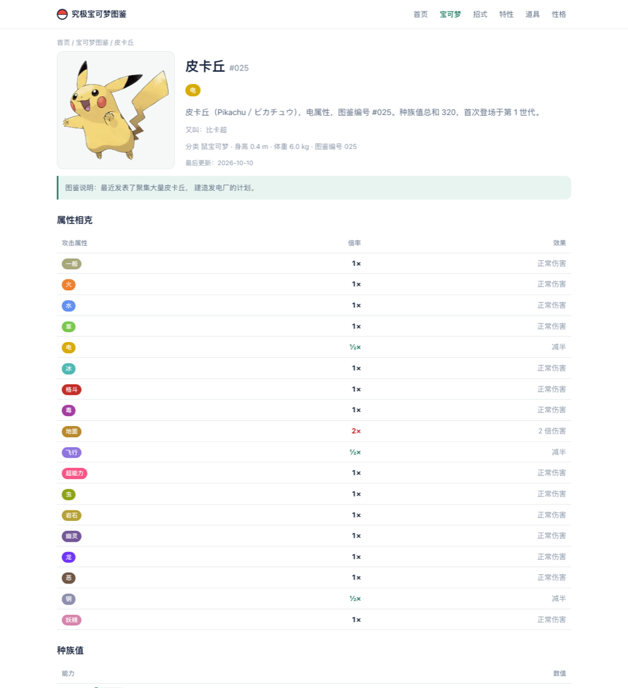
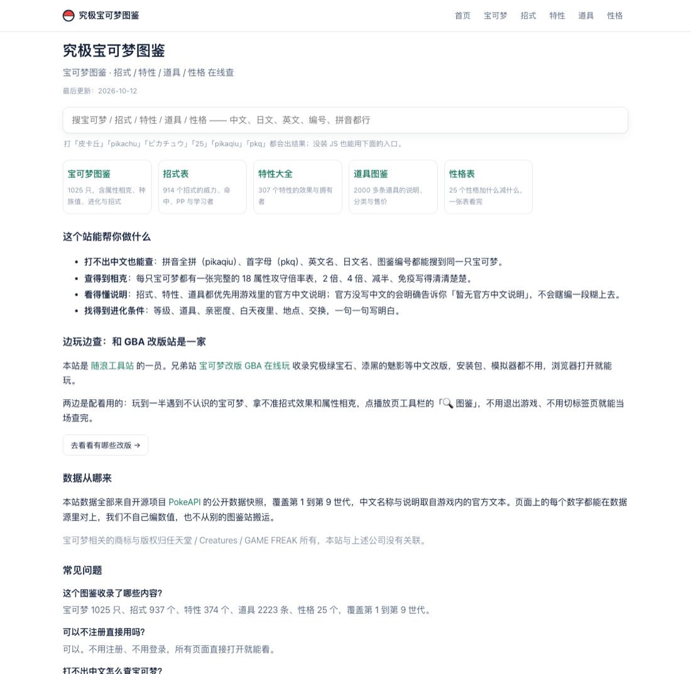

# 究极宝可梦图鉴 · 生成器

一个纯静态中文宝可梦资料库的**生成器**。宝可梦 / 招式 / 特性 / 道具 / 性格
五类数据，每个条目生成一个真静态 HTML 页 —— 首屏就有完整内容，不靠 JS 渲染。

[](LICENSE)
[](NOTICE.md)
[](https://nodejs.org/zh-cn)
[](https://workers.cloudflare.com/)

**在线版（每天都在更新，免费免注册）：<https://pokedex.suilang.net>**

<p align="center">
  <a href="https://pokedex.suilang.net/pokemon/pikachu">
    
  </a>
</p>

<p align="center">
  
  
</p>

<p align="center"><sub>左：<a href="https://pokedex.suilang.net/pokemon/pikachu">皮卡丘详情页</a>，属性相克表直接躺在 HTML 里
　右：<a href="https://pokedex.suilang.net/">首页</a>，搜索支持拼音</sub></p>

| | |
| --- | --- |
| 数据规模 | 宝可梦 1025 只 · 招式 937 个 · 特性 374 个 · 道具 2223 条 · 性格 25 个，覆盖第 1–9 世代 |
| 页面数量 | 约 3500 个静态页（在线站有 4100+，差在「数据与版权」那一节说的那份官方中文说明） |
| 部署 | Cloudflare Workers 静态资源（也可以丢到任何静态托管） |
| 依赖 | Python 3 + Node.js + Pillow，其余全是标准库 |
| 仓库体积 | 约 400 KB —— 数据和图片都不在里面，clone 后自己去上游下 |

克隆下来跑一次，本地就会得到一个和线上结构完全一样的完整站点。

---

## 这个生成器在解决什么问题

做资料站最常见的坑，这个生成器是照着这些坑设计的：

| 问题 | 一般做法 | 这里 |
| --- | --- | --- |
| 爬虫和 AI 抓到的是空页面 | 前端渲染，内容要等几 MB 的 JS 跑完才画出来 | **每条都是真静态页**，HTML 里直接就有结论、相克表、种族值、进化链 |
| 中文用户打不出想查的那个字 | 只支持中文和图鉴编号 | 支持**拼音全拼**（`pikaqiu`）、**首字母**（`pkq`）、英文名、日文名、图鉴编号 |
| 官方没写中文说明，于是自己编一段 | 编，或从别的图鉴站抄 | **明确写「暂无官方中文说明」**，不编、不搬 |
| 改一个字，`lastmod` 就往前推一天 | 每次构建都更新 | 写文件前先比内容，**只有正文真变了才推日期** |
| 官方从来没写过说明的条目也塞进列表 | 一堆只有英文名的空页拉低整站质量 | 页面照旧生成、搜索查得到，但带 `noindex`、不进 sitemap、不进导航 |
| 数据来源说不清 | 「参考了 PokéWiki」 | 逐条列出来源和授权，**每个数字都能在数据源里对上** |

---

## 快速开始

```bash
git clone https://github.com/lovehin/pokedex_online.git
cd pokedex_online

# 1. 装依赖（Pillow 是唯一的第三方库，其余都是标准库）
python3 -m pip install Pillow certifi

# 2. 下载上游数据（约 130 MB，只需一次，之后缓存在 build/_raw/）
python3 build/取数据.py

# 3. 处理图片（精灵图 → webp，分享图，PWA 图标）
python3 build/图片.py

# 4. CSV → JSON
python3 build/生成数据.py

# 5. 生成全部静态页 + sitemap + robots.txt + llms.txt
python3 build/生成页面.py

# 6. 自检（110 条断言）
python3 build/自测.py
```

macOS 上也可以直接双击：

- `scripts/重新上线.command` —— 生成 + 自检 + 上传到 Cloudflare
- `scripts/本地预览.command` —— 生成完在 <http://127.0.0.1:8850> 起个预览服务

每次推送和每个 PR 都会自动跑一遍上面这套流程（GitHub Actions），所以提交前本地跑一次能省你等待的时间。

---

## 目录结构

```
pokedex_online/
├── wrangler.jsonc          部署配置（改 name 成你自己的 Worker 名）
├── _headers                缓存与安全响应头（CSP 见「坑」）
├── _redirects              别名跳转
├── .assetsignore           哪些文件不上传
├── assets/
│   ├── config.js           ★ 唯一需要改的配置文件
│   ├── style.css           全站样式
│   └── app.js              搜索 / 列表筛选 / 道具弹层
├── build/
│   ├── 取数据.py            从 PokeAPI 下载 CSV 与官方图到 build/_raw/
│   ├── 取官方文本.py         可选：补 PokeAPI 缺的中文说明（见下）
│   ├── 官方文本.py          读补全结果，给 生成数据.py 兜底
│   ├── 生成数据.py          CSV → data/*.json 与 build/_out/*.json
│   ├── 图片.py              官方图 → img/*.webp + 分享图 + PWA 图标
│   ├── 生成页面.py          数据 → 全部静态页 + sitemap / robots.txt / llms.txt
│   ├── 自测.py              上线前全站自检（110 条断言）
│   ├── 模板.py              页面骨架、页头页脚、表格、FAQ
│   ├── 映射表.py            属性中文名与色值、进化条件怎么拼成人话
│   ├── 预览服务器.py         按 Cloudflare 的规则做本地预览
│   └── 人工数据/            手工维护的别名与属性中文名
└── scripts/                 双击就能用的两个 .command
```

**生成顺序是固定的**：`取数据 → 图片 → 生成数据 → 生成页面 → 自测`。
`重新上线.command` 已经按这个顺序串好了，单跑的时候别跳步。

**`assets/`、`data/`、`img/`、`og/` 和五个条目目录都是生成物**，手改会在下次生成时被覆盖。
要改内容就改 `build/` 下的脚本，或者改 `build/人工数据/`。
改完 css / js 记得把 `build/模板.py` 里的 `V` 加 1，否则访客拿的是缓存里的旧版。

---

## 数据与版权

⚠️ **请先读这一节再决定怎么用。**

代码（`build/`、`assets/`、`scripts/`、部署配置）以 MIT 协议开源，见 `LICENSE`。
**数据、精灵图、官方游戏文本不在授权范围内**，本仓库不包含、也不分发它们。
运行时它们由 `build/取数据.py` 从上游直接下载，各上游的条款由使用者自行承担。
逐条清单见 [`NOTICE.md`](NOTICE.md)。

| 素材 | 来源 | 授权情况 |
| --- | --- | --- |
| 表格数据、名称、种族值、进化链 | [PokeAPI/pokeapi](https://github.com/PokeAPI/pokeapi) | BSD-3-Clause（其许可里写明「宝可梦及角色名称是任天堂的商标」） |
| 精灵图 | [PokeAPI/sprites](https://github.com/PokeAPI/sprites) | **无许可文件**，图源自游戏提取 |
| 拼音 | [mozillazg/pinyin-data](https://github.com/mozillazg/pinyin-data) | MIT |

精灵图那一行是本仓库**不打包图片**的直接原因：把上千张来源不明的游戏截图放进公开仓库，
一旦被投诉就是整个仓库被下架，所以这里让每个人自己去上游取。

宝可梦相关商标与版权归**任天堂 / Creatures / GAME FREAK** 所有。
本项目是**无关联的非官方**工具，与任天堂等公司没有任何从属或授权关系，
不提供、不分发任何 ROM 或游戏文件。

三条数据铁律（写代码时请守住）：

1. **不编数据。** 官方没有中文说明的条目，页面直接写「暂无官方中文说明」，不自己翻译。
2. **不搬别人。** 不从任何图鉴站抓数据、抄文案。
3. **日期不乱跑。** 页面里的 `<!--DATE-->` 在写文件前先比内容，只有正文真的变了
   才把「最后更新」和 sitemap 的 `lastmod` 推到今天（状态记在 `build/.生成状态.json`）。

**薄内容不进站内导航。** 官方从来没写过中文说明的条目（GC《暗之旋风》的暗影招式、
《信长的野望》的部分特性等），页面照旧生成、站内搜索照样查得到，但带 `noindex`、
不进 sitemap、也不列进总览页 —— 一堆只有英文名的空页会拉低整站的内容质量。
判断依据是 `生成数据.py` 给这类条目打的 `thin` 字段。

---

## 部署到 Cloudflare Workers

1. 装 [Node.js](https://nodejs.org/zh-cn)
2. 改 `assets/config.js`：域名、站名、联系方式、统计、站长验证、广告位
3. 改 `wrangler.jsonc` 里的 `name` 成你自己的 Worker 名 —— **必须和你要用的名字一致**，
   写错不会报错，只会默默传到另一个新 Worker 上
4. 双击 `scripts/重新上线.command`，第一次会打开浏览器让你登录 Cloudflare
5. Cloudflare → Workers → 你的 Worker → 设置 → 域和路由 → 添加自定义域

部署完记得提交 sitemap：

- Google Search Console：建议用「网域资源 + DNS TXT」验证，一次覆盖所有子域
- 百度搜索资源平台：⚠️ **目前不支持 sitemap 提交**，只能走 API 一条条推

---

## 踩过的坑（改之前先看一眼）

1. **不要在 `_redirects` 里写 `/xxx` 与 `/xxx.html` 互指的规则。** Cloudflare 会把
   `/xxx.html` 自动归一成 `/xxx`，两边互相指就是无限重定向，表现为「重定向次数过多」。
   无后缀地址是靠 `html_handling: auto-trailing-slash` 自动对应的。
2. **`.assetsignore` 里不能写 `*.txt`。** 会连带排除 `robots.txt`、`llms.txt` 和站长平台
   的验证文件，验证和收录一起坏掉。本地笔记请按文件名单独列。
3. **栏目根地址要带结尾斜杠。** Cloudflare 会把 `/pokemon` 307 到 `/pokemon/`，
   所以 canonical / og:url / sitemap / 页内链接统一用 `/pokemon/`。
   条目页（`/pokemon/pikachu`）不带斜杠。新增栏目页时写 `写页('xxx/index', ...)`。
4. **CSV 里的布尔值是 `'0'` / `'1'` 字符串，而 `'0'` 在 Python 里是真。**
   判断进化开关务必走 `映射表._有()`，否则「亲密度 220 以上」会被拼成
   「下雨时，把主机倒过来……」。
5. **搜索索引里不要存 Promise。** 已拿到的数组放 `索引`，正在下载的放另一个 `等待`，
   混在一起会让搜索永远查不到东西。
6. **部分 Python 安装（尤其 python.org 的 3.8）没自带根证书**，下 https 会报
   `CERTIFICATE_VERIFY_FAILED`。`取数据.py` 里已经优先用 certifi、退而用
   `/etc/ssl/cert.pem`，装一下 `certifi` 即可，别删这段。

---

## 本地开发

```bash
python3 build/预览服务器.py 8850     # 改完页面刷这个地址
python3 build/自测.py                 # 只检查，不改文件
```

`预览服务器.py` 按 Cloudflare 的地址规则找文件（`/pokemon/pikachu` → `pokemon/pikachu.html`），
所以本地预览效果和线上一致；Python 自带的 `http.server` 不认这个规则，直接用它会满屏 404。

提交 PR 的话先看一眼 `.github/PULL_REQUEST_TEMPLATE.md` 里的检查清单 ——
尤其是「改了 css / js 要把 `build/模板.py` 里的 `V` 加 1」这条，漏了不会报错，
只会让访客拿到旧版缓存，很难发现。

---

## 提 issue 之前

**数据错了不要在这里提。** 本站的数据来自 PokeAPI 的公开快照，这个仓库改不了上游 ——
去 [在线版](https://pokedex.suilang.net/) 反馈，那边才是处理数据纠错的地方。
这里只管**代码**：生成脚本、页面结构、样式、搜索交互、部署。

---

## 姊妹站

<p align="center">
  <a href="https://gba.suilang.net">
    
  </a>
</p>

**[宝可梦改版 GBA 在线玩](https://gba.suilang.net)** —— 同一个作者做的另一个站：
不用装模拟器，手机浏览器打开就能玩究极绿宝石、漆黑的魅影等中文改版，支持倍速、
即时存档、金手指。

两个站是**配套**的，所以做了内嵌联动：游戏播放页的工具栏有个「🔍 图鉴」按钮，
把本站的极简查询页浮在游戏画面上方 —— 玩到一半遇到不认识的宝可梦，
打名字或拼音就能查属性相克和种族值，不用退出游戏、不用切标签页。

- 在线版：<https://gba.suilang.net>
- 整个工具站合集：<https://suilang.net>

---

## 关于这个仓库

在线版 <https://pokedex.suilang.net> 由 [随浪工具站](https://suilang.net) 维护，
是这个生成器的实际使用现场。想用中文资料库、又不想自己搭，直接用在线版最快。

## License

代码部分 MIT，见 [`LICENSE`](LICENSE)。数据、精灵图、官方游戏文本不在授权范围内 ——
哪些算代码、哪些不算，以及商标声明，逐条列在 [`NOTICE.md`](NOTICE.md)。